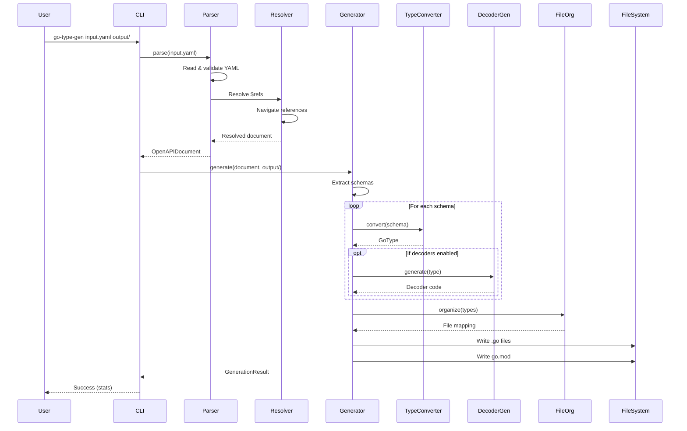

# Architecture Documentation

This document provides a comprehensive overview of the Go Type Generator's architecture, design decisions, and internal structure.

## System Overview

Go Type Generator is a TypeScript-based tool that transforms OpenAPI 3.0/3.1 specifications into idiomatic Go type definitions with optional runtime decoders.

### High-Level Architecture

```
┌─────────────────┐
│   CLI / API     │  Entry points for users
└────────┬────────┘
         │
         ▼
┌─────────────────┐
│ OpenAPI Parser  │  Parse and validate OpenAPI specs
└────────┬────────┘
         │
         ▼
┌─────────────────┐
│ Ref Resolver    │  Resolve $ref references
└────────┬────────┘
         │
         ▼
┌─────────────────┐
│  Go Generator   │  Orchestrate type generation
└────────┬────────┘
         │
         ├─────────────────┬──────────────────┬─────────────────┐
         ▼                 ▼                  ▼                 ▼
┌──────────────┐  ┌──────────────┐  ┌──────────────┐  ┌──────────────┐
│Type Converter│  │File Organizer│  │Decoder Gen   │  │Template Eng  │
└──────────────┘  └──────────────┘  └──────────────┘  └──────────────┘
         │                 │                  │                 │
         └─────────────────┴──────────────────┴─────────────────┘
                                    │
                                    ▼
                          ┌─────────────────┐
                          │  Go Files (.go) │
                          └─────────────────┘
```

## Component Breakdown

### 1. CLI Entry Point (src/cli.ts)

**Responsibility**: Command-line interface and user interaction

**Key Features**:
- Parses command-line arguments using Commander.js
- Validates user input
- Orchestrates the generation pipeline
- Provides user feedback (verbose mode, progress)

**Flow**:
```typescript
CLI Arguments → Validation → Parser → Generator → File Output → User Feedback
```

**Interface**:
```typescript
interface CLIOptions {
  packageName?: string;
  grouping?: 'category' | 'single' | 'custom';
  verbose?: boolean;
  format?: 'yaml' | 'json' | 'auto';
  version?: '3.0' | '3.1' | 'auto';
  generateDecoders?: boolean;
  generateValidation?: boolean;
}
```

### 2. OpenAPI Parser (src/parser/OpenAPIParser.ts)

**Responsibility**: Parse and validate OpenAPI specifications

**Key Features**:
- Reads YAML and JSON files
- Validates against OpenAPI 3.0/3.1 schemas
- Normalizes the document structure
- Extracts components/schemas

**Algorithm**:
```typescript
class OpenAPIParser {
  async parse(filePath: string): Promise<OpenAPIDocument> {
    // 1. Read file
    const content = await fs.readFile(filePath, 'utf-8');

    // 2. Parse based on format
    const raw = this.isJSON(content)
      ? JSON.parse(content)
      : yaml.load(content);

    // 3. Validate structure
    this.validate(raw);

    // 4. Normalize document
    return this.normalize(raw);
  }
}
```

**Design Decisions**:
- **Auto-detection**: Automatically detects YAML vs JSON
- **Strict validation**: Fails fast on invalid specs
- **Version detection**: Supports both OpenAPI 3.0 and 3.1

### 3. Reference Resolver (src/resolver/ReferenceResolver.ts)

**Responsibility**: Resolve `$ref` references across files

**Key Features**:
- Resolves local references (`#/components/schemas/User`)
- Resolves cross-file references (`./user.yaml#/User`)
- Prevents circular reference infinite loops
- Caches resolved references for performance

**Algorithm**:
```typescript
class ReferenceResolver {
  resolve(ref: string, baseDocument: OpenAPIDocument): Schema {
    // 1. Check cache
    if (this.cache.has(ref)) {
      return this.cache.get(ref);
    }

    // 2. Parse reference
    const { file, path } = this.parseRef(ref);

    // 3. Load external file if needed
    const doc = file ? this.loadExternalDoc(file) : baseDocument;

    // 4. Navigate to path
    const schema = this.navigateToPath(doc, path);

    // 5. Cache and return
    this.cache.set(ref, schema);
    return schema;
  }

  private navigateToPath(doc: any, path: string): any {
    return path.split('/').reduce((obj, key) => obj[key], doc);
  }
}
```

**Circular Reference Handling**:
```typescript
// Track resolution stack
private resolutionStack: Set<string> = new Set();

resolve(ref: string): Schema {
  if (this.resolutionStack.has(ref)) {
    throw new Error(`Circular reference detected: ${ref}`);
  }

  this.resolutionStack.add(ref);
  const result = this.doResolve(ref);
  this.resolutionStack.delete(ref);

  return result;
}
```

### 4. Go Generator (src/generator/GoGenerator.ts)

**Responsibility**: Orchestrate the entire code generation process

**Key Features**:
- Coordinates all generation steps
- Manages file organization strategy
- Applies generation options (decoders, validation)
- Collects statistics

**Generation Pipeline**:
```typescript
class GoGenerator {
  async generate(document: OpenAPIDocument, outputPath: string): Promise<GenerationResult> {
    // 1. Extract schemas
    const schemas = this.extractSchemas(document);

    // 2. Convert to Go types
    const types = schemas.map(schema =>
      this.typeConverter.convert(schema)
    );

    // 3. Generate decoders (if enabled)
    if (this.options.generateDecoders) {
      types.forEach(type => {
        type.decoder = this.decoderGen.generate(type);
      });
    }

    // 4. Organize into files
    const files = this.fileOrganizer.organize(types);

    // 5. Write to disk
    await this.writeFiles(files, outputPath);

    // 6. Generate go.mod
    await this.generateGoMod(outputPath);

    // 7. Return statistics
    return this.collectStats(types, files);
  }
}
```

### 5. Type Converter (src/generator/TypeConverter.ts)

**Responsibility**: Convert OpenAPI types to Go types

**Type Mapping Table**:

| OpenAPI Type | OpenAPI Format | Constraints | Go Type | Notes |
|-------------|----------------|-------------|---------|-------|
| `string` | - | - | `string` | |
| `string` | `date` | - | `time.Time` | Imports time |
| `string` | `date-time` | - | `time.Time` | Imports time |
| `string` | - | `enum` | Custom type | With constants |
| `integer` | `int32` | - | `int32` | |
| `integer` | `int64` | - | `int64` | |
| `integer` | - | 0-255 | `uint8` | Smart sizing |
| `number` | `float` | - | `float32` | |
| `number` | `double` | - | `float64` | |
| `boolean` | - | - | `bool` | |
| `array` | - | - | `[]T` | T is item type |
| `object` | - | - | `struct` | Named type |
| `object` | - | `additionalProperties` | `map[string]T` | |

**Constraint-Based Type Selection**:
```typescript
convertInteger(schema: IntegerSchema): string {
  const min = schema.minimum ?? 0;
  const max = schema.maximum ?? Number.MAX_SAFE_INTEGER;

  // Smart type selection based on constraints
  if (min >= 0 && max <= 255) return 'uint8';
  if (min >= -128 && max <= 127) return 'int8';
  if (min >= 0 && max <= 65535) return 'uint16';
  if (min >= -32768 && max <= 32767) return 'int16';

  // Default based on format
  return schema.format === 'int32' ? 'int32' : 'int64';
}
```

**Validation Tag Generation**:
```typescript
generateValidationTags(schema: Schema): string {
  const tags: string[] = [];

  if (schema.minimum !== undefined) {
    tags.push(`validate:"min=${schema.minimum}"`);
  }

  if (schema.maximum !== undefined) {
    tags.push(`validate:"max=${schema.maximum}"`);
  }

  if (schema.pattern) {
    tags.push(`validate:"regexp=${schema.pattern}"`);
  }

  return tags.join(' ');
}
```

### 6. Decoder Generator (src/generator/DecoderGenerator.ts)

**Responsibility**: Generate runtime type-safe parser functions

See [DECODER_DESIGN.md](./DECODER_DESIGN.md) for comprehensive details.

**Key Principles**:
- Input: `interface{}` (unmarshaled JSON)
- Output: `(*Type, error)` (pointer + error)
- Validation: Optional go-playground/validator integration

**Generation Strategy**:
```typescript
class DecoderGenerator {
  generate(type: GoType): string {
    if (type.category === 'enum') {
      return this.generateEnumDecoder(type);
    } else if (type.category === 'struct') {
      return this.generateStructDecoder(type);
    }
    return '';
  }

  private generateEnumDecoder(type: GoType): string {
    // Switch-case validation
    return `
      func parse${type.name}(raw interface{}) (*${type.name}, error) {
        str, ok := raw.(string)
        if !ok {
          return nil, fmt.Errorf("expected string, got %T", raw)
        }

        switch str {
          ${type.values.map(v => `case "${v}": ...`).join('\n')}
          default:
            return nil, fmt.Errorf("invalid value: %v", str)
        }
      }
    `;
  }
}
```

### 7. File Organizer (src/generator/FileOrganizer.ts)

**Responsibility**: Organize generated types into files

**Strategies**:

#### Category Strategy (Default)
```
output/
├── models.go      # Regular objects (User, Product)
├── enums.go       # Enum types (Status, Category)
├── requests.go    # Request types (*Request)
├── responses.go   # Response types (*Response)
└── errors.go      # Error types (*Error)
```

**Categorization Logic**:
```typescript
categorize(type: GoType): string {
  if (type.isEnum) return 'enums';
  if (type.name.endsWith('Request')) return 'requests';
  if (type.name.endsWith('Response')) return 'responses';
  if (type.name.endsWith('Error')) return 'errors';
  return 'models';
}
```

#### Single File Strategy
```
output/
└── types.go  # All types in one file
```

#### Custom Strategy
User provides a function to determine file placement.

### 8. Template Engine (src/templates/)

**Responsibility**: Generate Go code from templates

**Template Types**:

1. **Struct Template** (src/templates/struct.ts):
```typescript
export const structTemplate = (type: GoType) => `
// ${type.name} ${type.description}
type ${type.name} struct {
  ${type.fields.map(field => `
    ${field.name} ${field.type} \`json:"${field.jsonName}"${field.omitempty ? ',omitempty' : ''}"\`
  `).join('\n')}
}
`;
```

2. **Enum Template** (src/templates/enum.ts):
```typescript
export const enumTemplate = (type: GoType) => `
type ${type.name} string

const (
  ${type.values.map((value, idx) =>
    `${type.name}${capitalize(value)} ${type.name} = "${value}"`
  ).join('\n')}
)
`;
```

3. **Decoder Template** (src/templates/decoder.ts):
```typescript
export const decoderTemplate = (type: GoType) => `
func parse${type.name}(raw interface{}) (*${type.name}, error) {
  // Implementation depends on type category
  ${generateDecoderBody(type)}
}
`;
```

## Data Flow

### Complete Generation Flow



## Design Patterns

### 1. Builder Pattern

Used in `GoGenerator` to configure generation options:

```typescript
const generator = new GoGenerator()
  .withPackageName('myapi')
  .withDecoders(true)
  .withValidation(true)
  .build();
```

### 2. Strategy Pattern

Used in `FileOrganizer` for different file organization strategies:

```typescript
interface OrganizationStrategy {
  organize(types: GoType[]): FileMapping;
}

class CategoryStrategy implements OrganizationStrategy { }
class SingleFileStrategy implements OrganizationStrategy { }
class CustomStrategy implements OrganizationStrategy { }
```

### 3. Template Method Pattern

Used in code generation:

```typescript
abstract class CodeGenerator {
  generate(type: GoType): string {
    const header = this.generateHeader(type);
    const body = this.generateBody(type);  // Abstract
    const footer = this.generateFooter(type);
    return header + body + footer;
  }

  protected abstract generateBody(type: GoType): string;
}
```

### 4. Visitor Pattern

Used for traversing OpenAPI schemas:

```typescript
interface SchemaVisitor {
  visitObject(schema: ObjectSchema): void;
  visitArray(schema: ArraySchema): void;
  visitPrimitive(schema: PrimitiveSchema): void;
}
```

## Extension Points

### Adding New Type Mappings

Extend `TypeConverter`:

```typescript
class CustomTypeConverter extends TypeConverter {
  protected convertCustomType(schema: CustomSchema): string {
    // Your custom logic
    return 'CustomGoType';
  }
}
```

### Adding New File Organization Strategies

Implement `OrganizationStrategy`:

```typescript
class DomainStrategy implements OrganizationStrategy {
  organize(types: GoType[]): FileMapping {
    // Organize by domain logic
    return groupBy(types, t => t.domain);
  }
}
```

### Adding New Generators

Create a new generator class:

```typescript
class ValidatorGenerator {
  generate(type: GoType): string {
    // Generate Validate() methods
    return `func (${type.receiverName} *${type.name}) Validate() error { ... }`;
  }
}
```

## Performance Considerations

### Caching

- **Reference Resolution**: Resolved `$ref`s are cached
- **Type Conversion**: Previously converted types are memoized

### Streaming

For large specs:
- Schemas are processed in batches
- Files are written incrementally
- Memory is released after each batch

### Parallelization

Currently single-threaded, but designed for future parallelization:
- Each schema can be converted independently
- Each file can be written independently

## Error Handling

### Error Categories

1. **Parse Errors**: Invalid YAML/JSON syntax
2. **Validation Errors**: Invalid OpenAPI structure
3. **Resolution Errors**: Missing `$ref` targets
4. **Generation Errors**: Type conversion failures
5. **I/O Errors**: File system access issues

### Error Propagation

```typescript
try {
  const document = await parser.parse(input);
  const result = await generator.generate(document, output);
} catch (error) {
  if (error instanceof ParseError) {
    console.error('Failed to parse:', error.message);
  } else if (error instanceof ValidationError) {
    console.error('Invalid OpenAPI:', error.details);
  } else {
    console.error('Unexpected error:', error);
  }
  process.exit(1);
}
```

## Testing Strategy

### Unit Tests
- Individual type conversions
- Reference resolution logic
- Decoder generation

### Integration Tests
- Complete generation workflows
- File organization strategies
- End-to-end CLI execution

### Snapshot Tests
- Generated code structure
- Ensures no unintended changes

## Future Enhancements

### Planned Features
1. **Union Types**: Support for `oneOf`/`anyOf`
2. **Polymorphism**: Interface generation for discriminated unions
3. **Custom Templates**: User-provided code templates
4. **Go Modules**: Better go.mod management
5. **Documentation Generation**: GoDoc comments from OpenAPI descriptions

### Architecture Changes
1. **Plugin System**: Allow custom generators via plugins
2. **Incremental Generation**: Only regenerate changed types
3. **Watch Mode**: Auto-regenerate on spec file changes

## Related Documentation

- [DECODER_DESIGN.md](./DECODER_DESIGN.md) - Detailed decoder implementation
- [DEVELOPMENT.md](./DEVELOPMENT.md) - Development setup and workflow
- [API.md](./API.md) - Programmatic usage guide
- [CONTRIBUTING.md](./CONTRIBUTING.md) - Contribution guidelines
